# Domain discovery (event storming)

Status: Draft · Last updated: 2026-10-14 · Related: [ubiquitous language](02-ubiquitous-language.md), [bounded contexts](03-bounded-contexts.md)

## Table of contents

- [Method](#method)
- [Actors](#actors)
- [Big-picture timeline](#big-picture-timeline)
- [Commands, events and policies](#commands-events-and-policies)
- [Hotspots and open questions](#hotspots-and-open-questions)

## Method

A solo, document-based event storming: list domain events in past tense, then add the commands that cause them,
the aggregates that handle them, and the policies ("whenever X then Y") that react. Colours of the classic
technique map to the legend below.

## Actors

Visitor, Subscriber, Administrator, Scheduler (system), City open-data feed (external system), Email provider (external), Bluesky (external).

## Big-picture timeline

```mermaid
flowchart LR
    classDef actor fill:#fff3b0,stroke:#333,color:#000
    classDef cmd fill:#a5d8ff,stroke:#333,color:#000
    classDef agg fill:#ffe066,stroke:#333,color:#000
    classDef evt fill:#ffa94d,stroke:#333,color:#000
    classDef pol fill:#d0bfff,stroke:#333,color:#000

    sch([Scheduler]):::actor --> c1[Import dataset]:::cmd
    c1 --> a1{{ImportBatch}}:::agg
    a1 --> e1>ViolationsImported]:::evt
    a1 --> e2>NewViolationsDetected]:::evt
    e2 --> p1[/Notify watchers/]:::pol
    e2 --> p2[/Publish to Bluesky/]:::pol
    e2 --> p3[/Email digest to configured recipient/]:::pol
    p1 --> e3>WatcherAlertSent]:::evt

    adm([Administrator]):::actor --> c2[Correct establishment]:::cmd
    c2 --> a2{{Establishment}}:::agg
    a2 --> e4>EstablishmentCurated]:::evt
    adm --> c3[Delete establishment]:::cmd
    c3 --> a2
    a2 --> e5>EstablishmentDeleted]:::evt
    adm --> c4[Restore revision]:::cmd
    c4 --> a2

    vis([Visitor]):::actor --> c5[Request inspection]:::cmd
    c5 --> a3{{InspectionRequest}}:::agg
    a3 --> e6>InspectionRequested]:::evt
    vis --> c6[Withdraw request]:::cmd
    c6 --> a3
    a3 --> e7>InspectionRequestWithdrawn]:::evt

    sub([Subscriber]):::actor --> c7[Register]:::cmd
    c7 --> a4{{Subscriber}}:::agg
    a4 --> e8>SubscriberRegistered]:::evt
    sub --> c8[Watch / unwatch establishment]:::cmd
    c8 --> a4
    a4 --> e9>WatchlistChanged]:::evt
```

Legend: yellow = actor, blue = command, gold = aggregate, orange = domain event, purple = policy.

## Commands, events and policies

| Command | Aggregate | Event(s) | Policy reacting |
|---|---|---|---|
| ImportDataset | ImportBatch (Ingestion) | ViolationsImported, NewViolationsDetected | Notify watchers; post to Bluesky; email digest |
| CorrectEstablishment | Establishment (Registry) | EstablishmentCurated | none |
| DeleteEstablishment | Establishment | EstablishmentDeleted | Cascade deletion revisions to its violations |
| RestoreRevision | Establishment / Violation | EstablishmentCurated | none |
| RequestInspection | InspectionRequest | InspectionRequested | none (stored; future: forward to the city) |
| WithdrawInspectionRequest | InspectionRequest | InspectionRequestWithdrawn | none |
| RegisterSubscriber | Subscriber (Watchlist) | SubscriberRegistered | none |
| WatchEstablishment / UnwatchEstablishment | Subscriber | WatchlistChanged | none |

Key policies:

1. **New means unseen**: a violation is new if no revision exists for its `ProsecutionId`.
2. **Local curation wins**: an admin revision is never superseded by a later import revision in the current view, but the import is still recorded.
3. **Alert once**: each new violation produces at most one alert per subscriber (outbox, idempotent).

## Hotspots and open questions

- Does the feed ever remove rows? If a violation disappears upstream, record an Import "absent" marker rather than deleting (decide in [ADR-0006](adr/0006-append-only-revisions.md)).
- Identity of an establishment: `business_id` is stable, but names change; the establishment name in a watchlist is matched by `BusinessId` when known.
- Inspection requests: the city has no public API to forward them to, so they are stored and shown to the admin only.
- Dataset license: confirm the reuse terms before public launch.
