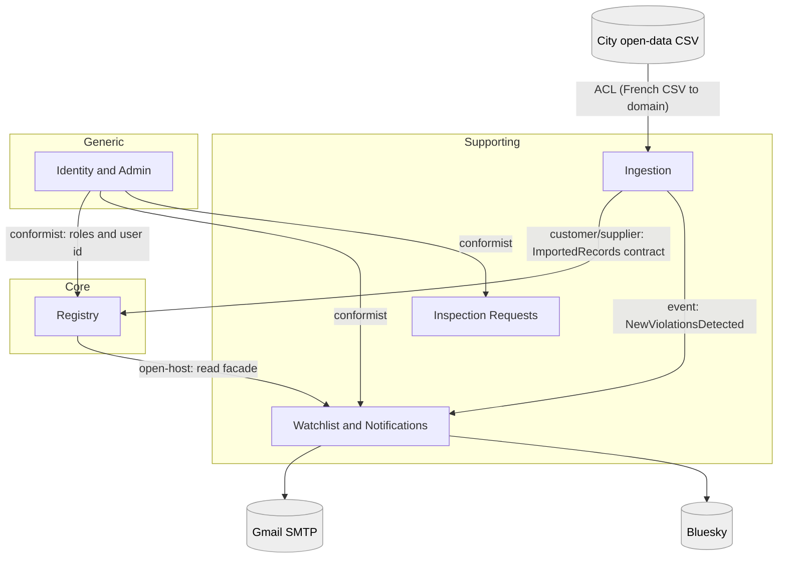

# Bounded contexts

Status: Draft · Last updated: 2026-10-14 · Related: [ADR-0001](adr/0001-modular-monolith-ddd-hexagonal.md), [ADR-0002](adr/0002-sqlite-ef-core-db-context-per-module.md)

## Table of contents

- [Context map](#context-map)
- [Contexts](#contexts)
- [Relationships and contracts](#relationships-and-contracts)
- [Integration events](#integration-events)

## Context map

## Contexts

| Context | Type | Responsibility | Owns |
|---|---|---|---|
| Registry | Core | The authoritative, versioned view of establishments and violations; search; statistics; admin curation | Establishment, Violation, Revision tables |
| Ingestion | Supporting | Fetch and parse the CSV (ACL), diff against known revisions, hand records to Registry, announce new violations, schedule | ImportBatch, hashes, outbox |
| Watchlist and Notifications | Supporting | Subscribers, watched establishments, alert policies, email and Bluesky adapters | Subscriber, Watch, NotificationLog |
| Inspection Requests | Supporting | Citizen complaints about establishments | InspectionRequest |
| Identity and Admin | Generic | Authentication, roles, admin policy (ASP.NET Core Identity) | Users, roles |

## Relationships and contracts

- **Ingestion to Registry (customer/supplier)**: Registry publishes `IRegistryImportPort` in `Registry.Contracts`
  (`ApplyImportAsync(batch)`). Ingestion supplies normalised records; Registry decides revisions and precedence.
- **Registry to others (open-host service)**: `IRegistryQueries` facade and DTOs in `Registry.Contracts`.
  Other modules never reference Registry's domain or persistence.
- **Ingestion to Watchlist (published language)**: the `NewViolationsDetected` integration event.
- **Identity (conformist)**: other modules accept Identity's user id and role claims as-is.
- **Anti-corruption layer**: Ingestion translates French field names, date formats, decimal commas and status labels into domain types; nothing else knows the CSV shape.
- **Same word, different model**: *Establishment* in Watchlist is only a reference (`BusinessId` + display name), not the Registry aggregate.

## Integration events

| Event | Producer | Consumers | Payload (summary) |
|---|---|---|---|
| `ViolationsImported` | Ingestion | Registry (via port), observability | batch id, counts |
| `NewViolationsDetected` | Ingestion | Watchlist | batch id, list of (ProsecutionId, BusinessId, name, date, fine) |
| `EstablishmentCurated` / `EstablishmentDeleted` | Registry | none initially | establishment id, revision |

Delivery: in-process dispatcher plus a transactional outbox table so alerts are not lost or duplicated ([architecture](05-architecture.md#integration-events-and-the-outbox)).
