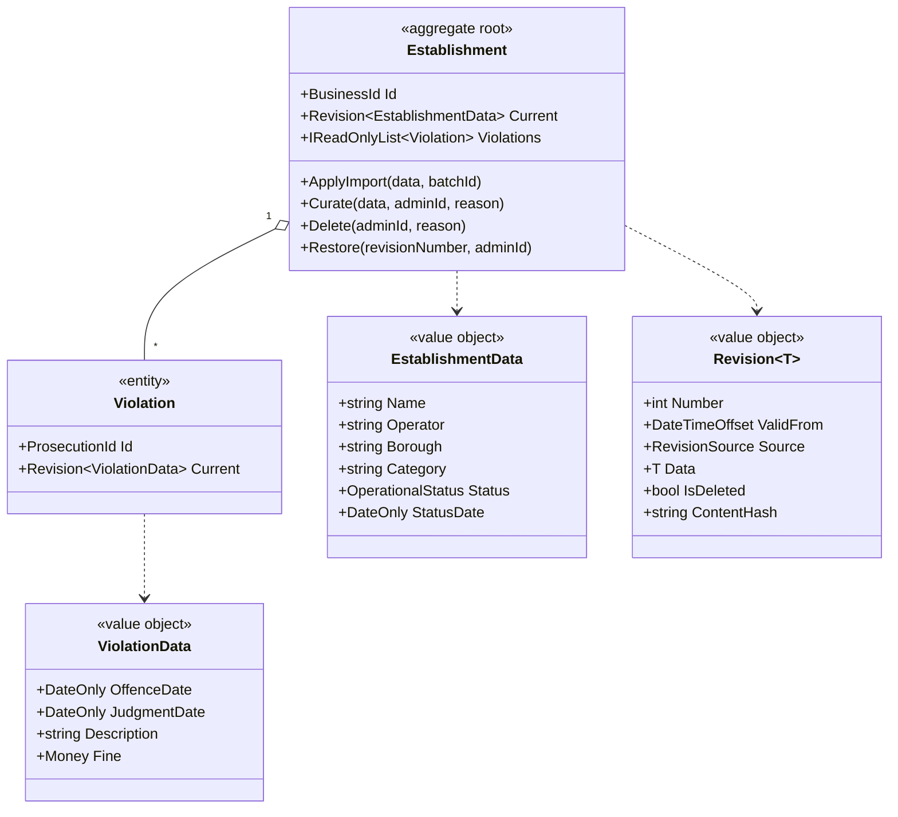
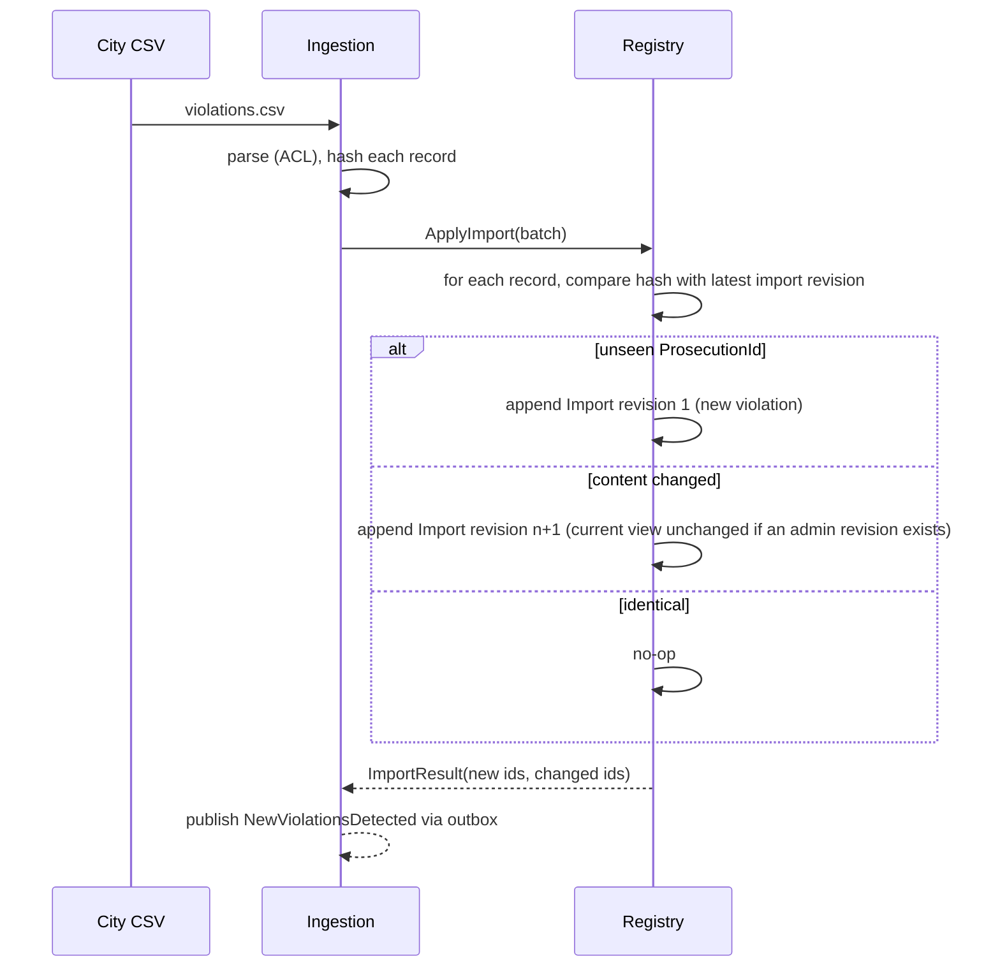

# Domain model

Status: Draft · Last updated: 2026-10-14 · Related: [ADR-0006](adr/0006-append-only-revisions.md), [ubiquitous language](02-ubiquitous-language.md)

## Table of contents

- [Registry context](#registry-context)
- [Revisions and the current view](#revisions-and-the-current-view)
- [Ingestion context](#ingestion-context)
- [Watchlist context](#watchlist-context)
- [Inspection Requests context](#inspection-requests-context)
- [Value objects](#value-objects)
- [Domain events](#domain-events)

## Registry context

Invariants (enforced in the domain, covered by unit tests):

- `Fine` is never negative.
- `JudgmentDate` is on or after `OffenceDate`.
- A `Violation` is unique by `ProsecutionId` within the registry.
- Revision numbers per entity are strictly increasing with no gaps; revisions are never modified or removed.
- Deleting an establishment appends a deletion revision to it and to each of its violations.

## Revisions and the current view

Nothing is overwritten or physically deleted. Each establishment and violation is an append-only list of revisions.

| Revision source | Created by | Effect on the current view |
|---|---|---|
| `Import(batchId)` | Ingestion, only when the incoming content hash differs from the latest import revision | Becomes current unless an admin revision exists |
| `Admin(userId, reason)` | Curate, Delete, Restore | Always becomes current and stays current over later imports |

Current view algorithm:

1. Take the latest admin revision if any; else the latest import revision.
2. If that revision has `IsDeleted`, the entity is hidden from normal queries (history queries still show it).
3. "Accept city version" appends a new admin revision whose data equals the latest import revision, which hands control back to the city feed in effect.

## Ingestion context

- `ImportBatch` (aggregate): id, started/finished timestamps, source URL, row counts, rejected rows with reasons, status.
- `CsvRecord` (ACL type): raw strings as read from the file, converted to domain types by a mapper that rejects bad rows individually.
- Port `IViolationFeed`: returns a stream of CSV bytes (HTTP adapter with retry, timeout and circuit breaker; fixture adapter in tests).

## Watchlist context

- `Subscriber` (aggregate root): id (= Identity user id), `EmailAddress`, watched establishments (`BusinessId` + display name), optional avatar (jpg/png, size-limited), locale.
- `NotificationLog`: (subscriber id, ProsecutionId) unique, guaranteeing at most one alert per violation per subscriber.
- Policy: on `NewViolationsDetected`, find subscribers watching each new violation's `BusinessId`, send one digest email per subscriber with a signed unsubscribe link; also send the configured-recipient digest and the Bluesky post.

## Inspection Requests context

- `InspectionRequest` (aggregate root): id, establishment name, address, city, visit date, complainant first/last name, description, status (Open, Withdrawn), created timestamp.
- Invariants: all fields required; visit date not in the future; description length bounded.

## Value objects

`BusinessId`, `ProsecutionId` (positive integers, strongly typed), `Money` (decimal CAD, non-negative, two places),
`DateRange` (from on or before to), `OperationalStatus` (enum), `EmailAddress` (validated), `ContentHash`, `RevisionSource`.
Shared ones (`Money`, `DateRange`) live in `SharedKernel`; the rest stay in their module.

## Domain events

| Event | Context | Raised when |
|---|---|---|
| `ViolationsImported` | Ingestion | A batch completes |
| `NewViolationsDetected` | Ingestion | A batch produced violations with no prior revision |
| `EstablishmentCurated` | Registry | Admin appends a revision (curate or restore) |
| `EstablishmentDeleted` | Registry | Admin deletes |
| `InspectionRequested` / `InspectionRequestWithdrawn` | Inspection Requests | Create / withdraw |
| `SubscriberRegistered` / `WatchlistChanged` | Watchlist | Registration / watch or unwatch |
