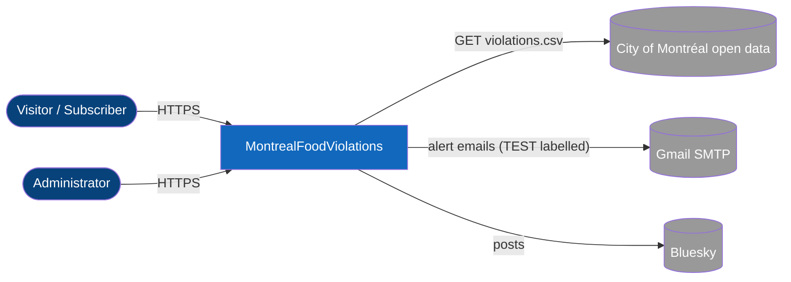
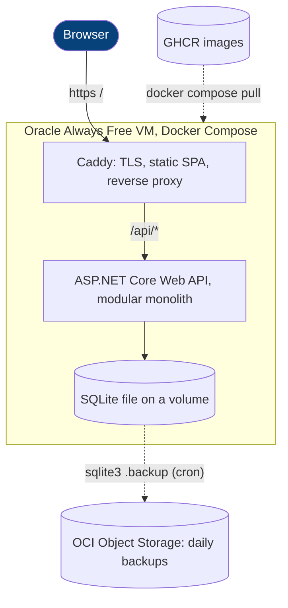
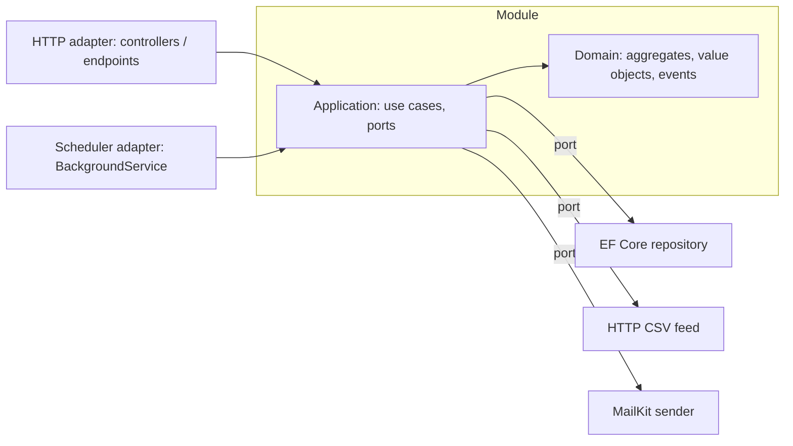

# Architecture

Status: Draft · Last updated: 2026-10-14 · Related: [ADR-0001](adr/0001-modular-monolith-ddd-hexagonal.md), [ADR-0002](adr/0002-sqlite-ef-core-db-context-per-module.md), [ADR-0003](adr/0003-docker-on-oracle-always-free-with-caddy.md)

## Table of contents

- [Style](#style)
- [System context (C4 level 1)](#system-context-c4-level-1)
- [Containers (C4 level 2)](#containers-c4-level-2)
- [Solution layout](#solution-layout)
- [Module anatomy (hexagon)](#module-anatomy-hexagon)
- [Dependency rules](#dependency-rules)
- [Integration events and the outbox](#integration-events-and-the-outbox)
- [Cross-cutting concerns](#cross-cutting-concerns)
- [Technology choices](#technology-choices)

## Style

A **modular monolith** whose module boundaries are the **bounded contexts**, with a **hexagonal** (ports and adapters)
structure inside each module. One deployable, one SQLite file, strong internal boundaries enforced by architecture tests.
The Angular SPA is a separate build served from the same origin as the API.

## System context (C4 level 1)



## Containers (C4 level 2)



## Solution layout

```text
MontrealFoodViolations.sln
src/
  SharedKernel/                 Result, AggregateRoot, IDomainEvent, Money, DateRange
  Modules/
    Registry/    Registry.Domain  Registry.Application  Registry.Infrastructure  Registry.Contracts
    Ingestion/   Ingestion.Domain Ingestion.Application Ingestion.Infrastructure Ingestion.Contracts
    Watchlist/   (added at increments 17 and 18)
    InspectionRequests/ (increment 16)
    Identity/    (increment 15)
  Host/Api/                     composition root + HTTP adapters
frontend/                       Angular SPA, Playwright e2e
tests/                          per-module unit and integration tests, Api.Tests, Architecture.Tests
infra/                          cloud-init.yml, compose.yml, Caddyfile, backup.sh
.github/workflows/              ci.yml, cd.yml, codeql.yml
```

A module may start as a single project with `Domain/`, `Application/`, `Infrastructure/` folders and `internal`
visibility, and be split into assemblies only when the architecture tests justify it.

## Module anatomy (hexagon)



- **Driving adapters** (left) call use cases. **Driven adapters** (right) implement ports defined in Application.
- Domain has no dependencies. Application depends on Domain only. Infrastructure depends on Application and Domain.

## Dependency rules

Enforced by `Architecture.Tests` (NetArchTest):

1. Inside a module: Domain references nothing; Application references Domain; Infrastructure references both; never the reverse.
2. Between modules: only `*.Contracts` assemblies may be referenced.
3. `Host/Api` is the only project that references every module.
4. Controllers contain no business logic (they map HTTP to use cases).
5. No module references another module's `DbContext`; no cross-module foreign keys.

## Integration events and the outbox

An in-process dispatcher delivers integration events between modules. Events that trigger external side effects
(email, Bluesky) are first written to an **outbox table** in the same transaction as the state change, then dispatched
by a `BackgroundService` and marked processed. This gives at-least-once delivery; the `NotificationLog` unique key
makes handlers idempotent, so alerts are effectively sent once.

## Cross-cutting concerns

| Concern | Approach |
|---|---|
| Configuration | Options pattern with `ValidateOnStart`; secrets from user-secrets (dev) or environment (prod) |
| Time | `TimeProvider` injected everywhere |
| Resilience | `Microsoft.Extensions.Http.Resilience` on the CSV feed client |
| Auth | ASP.NET Core Identity cookie auth, antiforgery, role policy `Admin` |
| Errors | `ProblemDetails` (RFC 9457), no stack traces to clients |
| Logging and telemetry | Serilog with redaction; OpenTelemetry traces and metrics; `/health` |
| API docs | OpenAPI at `/docs`; TypeScript client generated from the spec in CI |
| Localization | Angular translations (EN/FR); `.resx` for emails and validation messages |

## Technology choices

| Area | Choice | Why |
|---|---|---|
| Runtime | .NET 10, C# 14 | Current platform, portfolio relevance |
| API | ASP.NET Core Web API (controllers + minimal APIs) | Shows both styles |
| Persistence | EF Core 10 + SQLite | Zero cost, one file, easy backup |
| Frontend | Angular (standalone components, signals) | Requested; strong typing with generated client |
| Messaging | In-process + outbox | Right-sized; extractable later |
| Container | Docker, Caddy | Simple HTTPS on one VM |
| CI/CD | GitHub Actions, GHCR | Free, integrated |
| Cloud | Oracle Always Free | Zero cost |
