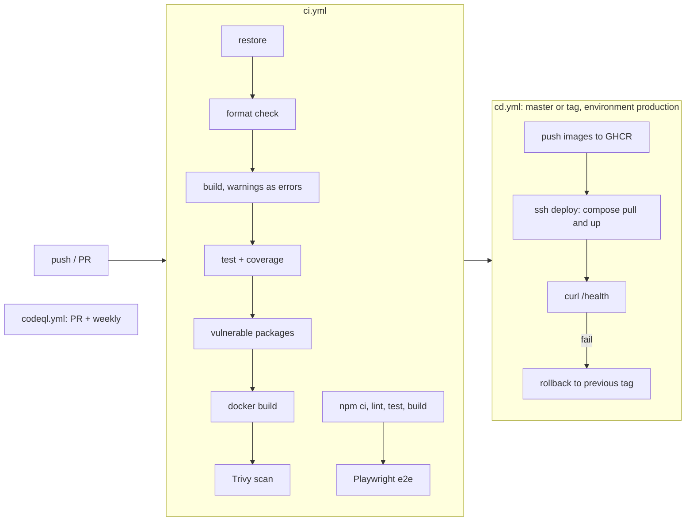

# CI/CD and deployment

Status: Draft · Last updated: 2026-10-14 · Related: [ADR-0003](adr/0003-docker-on-oracle-always-free-with-caddy.md), [ADR-0005](adr/0005-gmail-smtp-and-test-label.md), [ADR-0008](adr/0008-secrets-management.md)

## Table of contents

- [Pipelines](#pipelines)
- [Zero-cost guardrails](#zero-cost-guardrails)
- [Oracle setup runbook](#oracle-setup-runbook)
- [Deployment and rollback](#deployment-and-rollback)
- [Secrets](#secrets)
- [Backups and teardown](#backups-and-teardown)

## Pipelines

- `ci.yml`: .NET restore, `dotnet format --verify-no-changes`, build with warnings as errors, tests with coverlet, `dotnet list package --vulnerable`, Docker build, Trivy image scan; frontend lint, unit tests, production build, Playwright.
- `codeql.yml`: GitHub static analysis for C# and TypeScript on pull requests and weekly.
- `cd.yml`: on push to `master` after CI success (or `v*` tag): build and push `ghcr.io/<owner>/montreal-contraventions-{api,web}:<sha>`, deploy over SSH, smoke test, roll back on failure.
- Security steps are optional extras added in order; none blocks the first deployment. Trim to the NuGet vulnerability check plus Dependabot if CI time or noise becomes a problem.
- Third-party actions are pinned by commit SHA; workflow `permissions:` are minimal (packages write only in the publish job).

## Zero-cost guardrails

Hard requirement: nothing is billed at the end of the month.

- Stay on an Always Free account; **never upgrade to Pay As You Go**. Resources beyond free limits then stop working instead of being billed. Accept that Ampere A1 capacity may be unavailable; fall back to the free AMD micro shape.
- Compute: Ampere A1 up to 4 OCPU and 24 GB total (planned: 1 instance, 2 OCPU, 12 GB), or up to two `VM.Standard.E2.1.Micro`. Fallback: one micro with a 2 GB swap file and a `linux/amd64` image.
- Storage: boot volume at most 50 GB; Object Storage at most 20 GB with a retention rule (30 daily and 12 monthly backups).
- Network: ephemeral public IP only; no NAT gateway, no load balancer, no extra reserved IPs.
- No paid services: no OKE upgrade, no Vault HSM keys, no FastConnect. Only resources marked "Always Free-eligible".
- Safety net: OCI Budget of 1 USD with alerts at 1% and 100% of forecast and actual; review Cost Analysis monthly.
- Idle reclamation: Oracle may reclaim Always Free compute idle for 7 days (CPU, network and memory below ~20%). Keep a health-ping workflow, keep daily backups and `cloud-init` so a VM can be rebuilt quickly.
- GitHub Actions and GHCR are free for a public repository; DuckDNS or nip.io and Let's Encrypt are free.

## Oracle setup runbook

One-time, by hand in the OCI console (no Terraform or Ansible; see ADR-0003).

1. Create an Always Free account; pick the home region once (cannot be changed), preferring one with A1 capacity.
2. Create a budget of 1 USD with alert rules.
3. Create a VCN with a public subnet; security list: ingress 80 and 443 from anywhere, 22 only from your IP.
4. Launch an Ubuntu instance on `VM.Standard.A1.Flex` (2 OCPU, 12 GB, 50 GB boot) with `infra/cloud-init.yml` as user data. If out of capacity, retry periodically, else use `VM.Standard.E2.1.Micro` and `linux/amd64`.
5. `cloud-init.yml` installs Docker and the compose plugin, enables unattended upgrades, creates the non-root `deploy` user and installs the restricted deploy key.
6. Create a free DNS name (DuckDNS or nip.io) pointing at the VM public IP.
7. Create an Object Storage bucket for backups with a lifecycle rule.
8. Add the GitHub Environment `production` secrets (see below) and run the `cd` workflow.

## Deployment and rollback

1. CD pushes versioned images, then SSHes as `deploy` and runs the restricted wrapper (`docker compose pull && up -d`).
2. Migrations run on application start (one `DbContext` per module).
3. Smoke test: `curl -fsS https://<host>/health` and one API read.
4. On failure, the previous image tag recorded in `.env.previous` is re-applied.

## Secrets

Full policy in [ADR-0008](adr/0008-secrets-management.md).

| Where | Secrets |
|---|---|
| GitHub Environment `production` | `DEPLOY_SSH_KEY`, `DEPLOY_HOST`, `DEPLOY_KNOWN_HOSTS`, `GHCR_PULL_TOKEN` (only for private packages), `ADMIN_PASSWORD_HASH`, `SMTP_*`, `BLUESKY_*`, `DUCKDNS_TOKEN` |
| VM | `/opt/app/.env`, owner `deploy`, mode 600, written by CD |
| Local development | `dotnet user-secrets`; Mailpit for email |

- The deploy key is ed25519, used by a non-root user, restricted with `restrict,command="..."`; host key pinned in `known_hosts`.
- Rotation: change the value in the GitHub Environment and redeploy; rotate the deploy key and the pull token every 90 days.
- Secrets are never logged and never appear in OpenAPI or health output.

## Backups and teardown

- Backups ship in increment 13, before the feature checkpoint; the walking-skeleton deployment is increment 3 ([ADR-0010](adr/0010-early-deployment-and-backups.md)).
- Daily `sqlite3 .backup` to a temp file, upload to Object Storage, prune per retention. The Data Protection key ring is backed up with it. The backup is also the archive of record.
- Teardown runbook: delete the instance and its boot volume, the bucket and its objects, the DNS name; confirm Cost Analysis shows zero.
